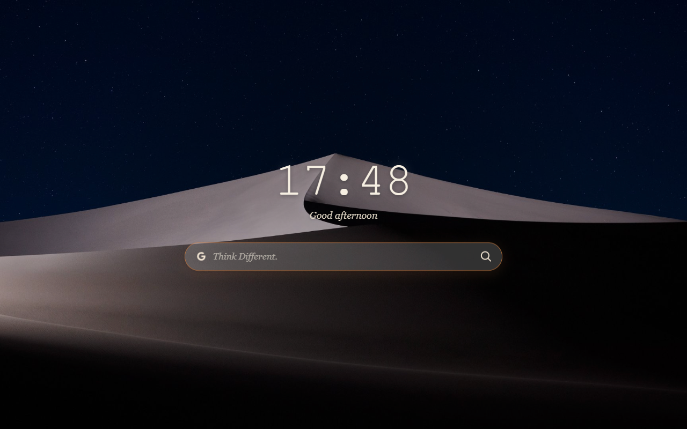
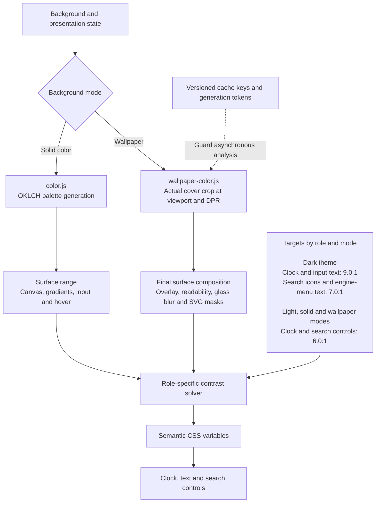

# WillowTab

**Languages:** English | [简体中文](README.zh-CN.md)

WillowTab is a clean and elegant new tab extension for Chromium-based browsers. It provides a focused search entry, multi-engine search switching, light and dark themes, and personal appearance settings so every new tab feels quieter and more comfortable.



## Key Features

### Clean Search Entry and Multi-Engine Switching

Use the centered search box to start searching quickly. WillowTab supports Google, Baidu, Bing, and DuckDuckGo, so you can choose the engine that fits your habits. You can also enable search suggestions to make keyword entry smoother.

### Personal Backgrounds

Use a solid color background or local images, manage multiple wallpapers, and switch them manually or automatically. Solid color mode
offers several soft presets and can also be adjusted manually. The search area adapts its accent color to the background; in wallpaper
mode, WillowTab adapts text, controls, and the search surface to the selected image.

### Light and Dark Themes

Choose light mode, dark mode, or follow the system appearance so the page stays comfortable across different times of day and usage environments.

### Appearance Customization

Adjust fonts, corner radius, shadow strength, settings button placement, and the browser tab title so the interface better matches your habits.

### Privacy-Friendly

WillowTab does not collect, track, or sell personal data.

WillowTab is for people who want a new tab page that stays simple, beautiful, and efficient without adding distracting information.

## Technical Implementation

### Adaptive Color and Rendered-Surface Analysis

WillowTab treats contrast as a semantic-role and final-rendered-surface problem rather than switching between one fixed light color and
one fixed dark color.



- [`css/style.css`](css/style.css) exposes semantic tokens for canvas text, search surfaces and controls, panels, accents, danger states,
  and wallpaper glass. Components consume these roles instead of sharing raw light/dark color values. The fixed dark theme uses stronger
  role-specific targets than the light theme: `9.0:1` for the clock and search input text, `7.0:1` for the two search icons and
  engine-menu text, `5.0:1` for the greeting, and `3.8:1` for the decorative motto. The input text has its own semantic token so
  raising its contrast does not also brighten the placeholder, motto, search suggestions, or other secondary copy.
- [`js/color.js`](js/color.js) generates solid-background palettes in OKLCH and evaluates each role against every surface it may occupy,
  including the base canvas, gradient endpoints, input surfaces, and selected or hover states. Body and search text plus search controls
  use separate targets; custom solid colors target `4.5:1` for ordinary text and `6.0:1` for the clock and two search icons. The solver
  tightens successful colors toward the limiting surface so they remain warm rather than jumping directly to pure black or white.
  Custom solid colors are limited to OKLCH lightness `0.32–1.00` and chroma `0–0.14`; previously saved out-of-range colors are projected
  to the nearest safe value on load. Chromatic backgrounds choose a search accent from the background hue and its `±25°` neighbors,
  while low-chroma backgrounds retain the warm brand accent; the settings panel and search area use separate `brandAccent` and
  `searchAccent` roles.
- [`js/wallpaper-color.js`](js/wallpaper-color.js) samples the actual `cover` crop at the current viewport and DPR, composites the global
  overlay and readability layer, reproduces the glass blur, and masks the exact SVG control shapes. The control solver first tries one
  warm candidate for each icon region, then uses the candidate that maximizes the lower of the two final-surface contrast values. The
  engine and submit icons therefore stay exactly the same color in each normal/hover state. Their wallpaper target is `6.0:1`; when a
  mixed surface makes that impossible, diagnostics record the best attainable shared result.
- Wallpaper analysis cache keys include the image, viewport, overlay, readability settings, blur, solver version, and element geometry.
  [`js/settings.js`](js/settings.js) also uses generation tokens so an older asynchronous analysis cannot overwrite a newer wallpaper or
  resized viewport result.
- [`scripts/validate-colors.js`](scripts/validate-colors.js) checks a 4,096-color RGB grid, 12 representative colors, fixed theme roles,
  light/dark/split/high-complexity wallpaper surfaces, strict shared-color controls, maximin candidate selection, best-effort diagnostics,
  deterministic safe-gamut projection, neighboring-hue search accents, soft presets, and one-step color boundaries.

## Install

### Microsoft Edge

Edge users should install WillowTab directly from Microsoft Edge Add-ons:

[Install from Microsoft Edge Add-ons](https://microsoftedge.microsoft.com/addons/detail/willowtab/ljkgjcbecpanckomdgebinggfhpkmmph)

### Google Chrome

Google Chrome users should install WillowTab directly from the Chrome Web Store:

[Install from Chrome Web Store](https://chromewebstore.google.com/detail/willowtab/gfigaeaddejhmnlkeppgccklahgepapm)

### Other Chromium Browsers

For other Chromium-based browsers, install manually from GitHub Releases:

[GitHub Releases](https://github.com/Un1quer23/WillowTab/releases/latest)

Download the generic `WillowTab-v*.zip` package from that release.

Manual installation steps:

1. Download the generic ZIP package.
2. Extract it to a local folder.
3. Open your browser's extension management page, such as `chrome://extensions`.
4. Enable Developer mode.
5. Click "Load unpacked" and select the extracted folder.

### Build Packages

This source builds `WillowTab-v1.7.10.zip` for Chromium-based browsers and `WillowTab-for-Chrome-v1.7.10.zip` for Chrome Web Store submission and review.

## Project Structure

```text
WillowTab/
├── manifest.json
├── newtab.html
├── privacy-policy.html
├── css/
│   └── style.css
├── js/
│   ├── assets.js
│   ├── clock.js
│   ├── color.js
│   ├── i18n.js
│   ├── preferences.js
│   ├── search.js
│   ├── settings.js
│   ├── theme.js
│   ├── wallpaper-color.js
│   └── wallpaper-policy.js
├── icons/
└── chrome-store/
```

The Chrome Web Store build lives in `chrome-store/`. Its policy-specific override files are `manifest.json`, `newtab.html`, `js/i18n.js`, and `README.md`.

## Privacy, Security, and Contributing

- [Privacy Policy](https://un1quer23.github.io/WillowTab/privacy-policy.html)
- [Security Policy](SECURITY.md)
- [Contributing](CONTRIBUTING.md)

## License

[GNU General Public License v3](LICENSE)

---

Think Different.
