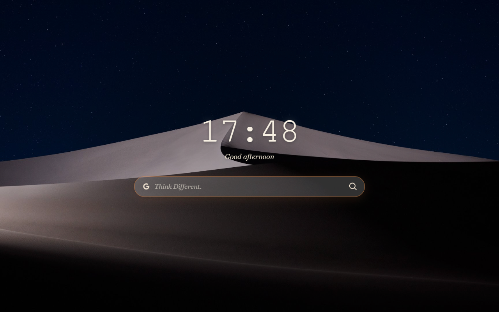
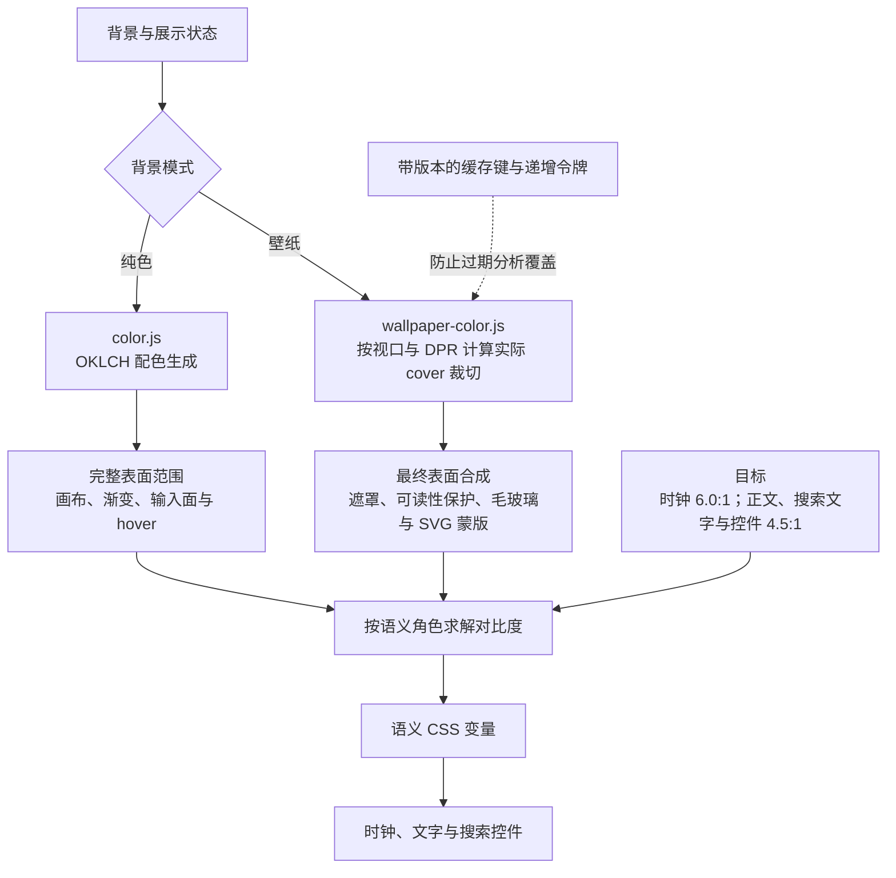

# WillowTab

**语言:** [English](README.md) | 简体中文

WillowTab 是一款简洁优雅的新标签页扩展，提供干净的搜索入口、多搜索引擎切换、浅色/深色主题和个性化外观设置，让每次打开新标签页都更专注、更舒适。



## 主要特性

### 简洁搜索入口 / 多引擎切换

你可以使用页面中央的搜索框快速开始搜索。WillowTab 支持多搜索引擎切换，你可以根据自己的习惯选择 Google、百度、Bing 或 DuckDuckGo；也可以开启搜索联想，让输入关键词更顺手。

### 个性化背景

支持纯色背景或本地图片，可管理多张壁纸，并按偏好手动选择或自动切换。壁纸模式会根据当前图片，
自动调整文字、控件和搜索框表面。

### 浅色 / 深色主题

支持浅色、深色以及跟随系统主题，在不同时间和使用环境下都保持舒适观感。

### 外观自定义

支持调整字体、圆角、阴影强度、设置按钮位置和标签页标题，让界面更贴近你的使用习惯。

### 隐私友好

WillowTab 不收集、不追踪、不出售个人数据。

WillowTab 适合希望新标签页保持简洁、美观、高效，同时又不想被复杂信息打扰的用户。

## 技术实现

### 自适应色彩与最终表面分析

WillowTab 不在浅色与深色文字之间简单切换，而是结合语义角色与最终渲染表面求解对比度。



- [`css/style.css`](css/style.css) 为画布文字、搜索表面与控件、面板、强调色、危险状态和壁纸毛玻璃定义语义令牌，
  组件使用这些角色，而不是共用一组固定的浅色或深色值。
- [`js/color.js`](js/color.js) 使用 OKLCH 为纯色背景生成配色，并针对每个角色可能出现的全部表面求解，包括画布基础色、
  渐变端点、输入面以及选中或 hover 状态。正文、搜索文字与搜索控件目标为 `4.5:1`，时钟目标为 `6.0:1`；问候语与格言
  则保持独立的视觉角色。求解成功后，颜色会向限制对比度的表面收紧，避免直接跳到生硬的纯黑或纯白。
- [`js/wallpaper-color.js`](js/wallpaper-color.js) 按当前视口与 DPR 采样壁纸的实际 `cover` 裁切，合成全局遮罩与可读性
  保护层，复现毛玻璃模糊，并按 SVG 的真实形状建立控件蒙版。控件求解器会先尝试让搜索引擎与提交图标共享颜色，只有
  两者同时满足对比度与视觉等价约束时才保留，否则分别为 normal/hover 状态求解。时钟始终不添加局部 scrim；搜索控件
  仅在单靠颜色无法达到 `4.5:1` 时使用精确到四位小数的最小 scrim。
- 壁纸分析缓存键包含图片、视口、遮罩、可读性设置、模糊、求解器版本和元素几何信息；[`js/settings.js`](js/settings.js)
  还使用递增令牌，防止较早完成的异步分析覆盖更新后的壁纸或视口结果。
- [`scripts/validate-colors.js`](scripts/validate-colors.js) 覆盖 4,096 个 RGB 网格色、12 个代表色、固定主题角色、明暗与分割
  壁纸表面、成对搜索控件、时钟无 scrim 行为、最小 scrim 边界以及单步颜色边界。

## 安装

### Microsoft Edge

Edge 用户建议直接从 Microsoft Edge 扩展商店安装：

[从 Microsoft Edge 扩展商店安装](https://microsoftedge.microsoft.com/addons/detail/willowtab/ljkgjcbecpanckomdgebinggfhpkmmph)

### Google Chrome

Google Chrome 用户建议直接从 Chrome Web Store 安装：

[从 Chrome Web Store 安装](https://chromewebstore.google.com/detail/willowtab/gfigaeaddejhmnlkeppgccklahgepapm)

### 其他 Chromium 浏览器

其他 Chromium 系浏览器用户，请从 GitHub Releases 手动安装：

[GitHub Releases](https://github.com/Un1quer23/WillowTab/releases/latest)

下载 `WillowTab-v1.7.3.zip`，也就是适用于 Chromium 系浏览器的通用版。

手动安装步骤：

1. 下载 `WillowTab-v1.7.3.zip`。
2. 解压到本地文件夹。
3. 打开浏览器扩展管理页面，例如 `chrome://extensions`。
4. 启用“开发者模式”。
5. 点击“加载已解压的扩展”，选择解压后的文件夹。

### Chrome Web Store Package / Chrome 商店特供包

`WillowTab-for-Chrome-v1.7.3.zip` 是为满足 Google 合规要求提供的 Chrome Web Store 特供版，主要用于 Chrome Web Store 提交和审核。

## 项目结构

```text
WillowTab/
├── manifest.json
├── newtab.html
├── privacy-policy.html
├── css/
│   └── style.css
├── js/
│   ├── i18n.js
│   ├── search.js
│   ├── clock.js
│   ├── settings.js
│   └── theme.js
├── icons/
└── chrome-store/
```

Chrome Web Store 版本位于 `chrome-store/`。其中 `manifest.json`、`newtab.html`、`js/search.js`、`js/settings.js`、`js/i18n.js`、`privacy-policy.html`、`README.md` 是审核策略相关的覆盖文件。

## 隐私、安全与贡献

- [隐私政策](https://un1quer23.github.io/WillowTab/privacy-policy.html)
- [安全政策](SECURITY.md)
- [贡献指南](CONTRIBUTING.md)

## 开源协议

[GNU General Public License v3](LICENSE)

---

Think Different.
